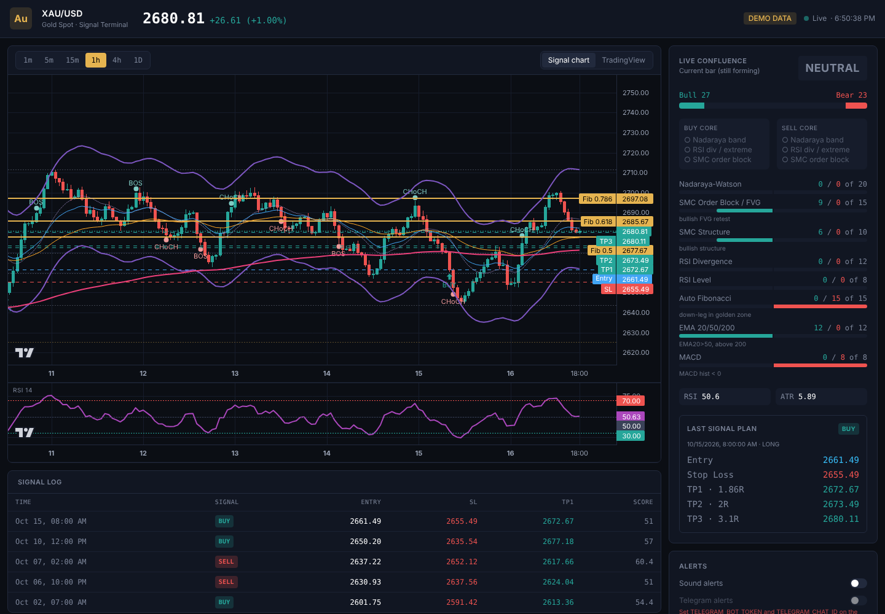

# XAU/USD Signal Terminal

Real-time gold (XAU/USD) charting with a multi-indicator **confluence signal engine**:
Nadaraya-Watson envelope, Smart Money Concepts (BOS/CHoCH, order blocks, FVGs), RSI with
divergence, Auto Fibonacci, EMA 20/50/200 and MACD. These combine into a weighted score that
outputs **STRONG BUY / BUY / NEUTRAL / SELL / STRONG SELL**, with ATR- and Fibonacci-based
**Entry, SL, TP1–TP3**. Alerts arrive as on-screen toasts, a sound, and Telegram messages.



> **Disclaimer:** signals are generated algorithmically from technical indicators. They are not
> financial advice, and no indicator combination is consistently accurate. Backtest and
> paper-trade before risking real money.

## Quick start

```bash
npm install
cp .env.example .env.local   # optional: add API keys (see below)
npm run dev                  # http://localhost:3000
```

With no API key the app runs on a **synthetic demo feed** (badge: `DEMO DATA`), so you can
try everything right away. For real prices, set one provider in `.env.local`:

| Provider | Env vars | Notes |
|---|---|---|
| [Twelve Data](https://twelvedata.com) | `TWELVEDATA_API_KEY` | The free plan allows ~800 requests/day, so the default poll is 60 s. Lower `POLL_INTERVAL_MS` on a paid plan. |
| [OANDA v20](https://developer.oanda.com) | `OANDA_API_KEY`, `OANDA_ENV=practice\|live` | A free practice account works. Polls every 5 s. |
| Demo | none | Deterministic synthetic prices, not real market data. |

`DATA_PROVIDER` forces a provider. Otherwise the first configured one is used.

### Telegram alerts

1. Create a bot with [@BotFather](https://t.me/BotFather) and copy the token.
2. Send your bot a message, then get your chat id (for example from [@userinfobot](https://t.me/userinfobot)).
3. Set `TELEGRAM_BOT_TOKEN` and `TELEGRAM_CHAT_ID`, restart, and turn on **Telegram alerts** in the sidebar.

The token stays on the server: the browser posts to `/api/telegram`, which relays the message.

### 24/7 alerts without a browser

The dashboard only alerts while it is open. To keep alerts running all the time, start the
headless worker on an always-on machine (VPS, Raspberry Pi, Railway, Fly.io…):

```bash
WORKER_TIMEFRAMES=15m,1h WORKER_MIN_LEVEL=STRONG npm run worker
```

It reads `.env.local`/`.env`, evaluates **closed** bars only, and sends new signals to Telegram.

## Scripts

| Command | What it does |
|---|---|
| `npm run dev` | Development server |
| `npm run build && npm start` | Production build and server |
| `npm test` | Unit tests for the indicators and signal engine (Vitest) |
| `npm run typecheck` / `npm run lint` | TypeScript and ESLint |
| `npm run worker` | Headless Telegram signal worker |

## Deploy to Vercel

1. Push this repository to GitHub.
2. On [vercel.com/new](https://vercel.com/new), import the repo. The framework is detected as Next.js.
3. Under **Settings → Environment Variables**, add your provider key and the Telegram variables.
4. Deploy. The API routes run as serverless functions.

Vercel functions cannot hold long-running connections, so the app polls via `/api/candles`
instead of keeping a WebSocket open. Run `npm run worker` somewhere else if you need 24/7 alerts.

## Project structure

```
src/
├── app/
│   ├── page.tsx                 # Dashboard: wires data → engine → chart/panels/alerts
│   ├── layout.tsx, globals.css
│   └── api/
│       ├── candles/route.ts     # GET ?tf=15m&limit=500 → provider candles (keys stay server-side)
│       └── telegram/route.ts    # POST {text} → Telegram Bot API (throttled)
├── components/
│   ├── PriceChart.tsx           # Lightweight Charts: candles, NW band, EMAs, markers, Fib/plan lines,
│   │                            #   OB/FVG zone overlay, synced RSI pane
│   ├── TradingViewWidget.tsx    # Official TradingView widget (OANDA:XAUUSD) as a reference view
│   ├── SignalPanel.tsx          # Live score breakdown, core checklist, trade plan
│   ├── SignalLog.tsx, ToastStack.tsx, SettingsPanel.tsx, Header.tsx, TimeframeSwitcher.tsx
├── hooks/
│   ├── useMarketData.ts         # History load + incremental polling
│   ├── useSignalAlerts.ts       # Toast / sound / Telegram on newly closed-bar signals
│   └── useSettings.ts           # Preferences in localStorage
└── lib/
    ├── types.ts
    ├── indicators/              # Pure, framework-free TypeScript
    │   ├── ma.ts, rsi.ts, macd.ts, atr.ts
    │   ├── nadaraya.ts          # Nadaraya-Watson envelope (non-repainting)
    │   ├── pivots.ts, smc.ts    # Swings, BOS/CHoCH, order blocks, FVGs
    │   ├── divergence.ts        # Regular RSI divergence
    │   └── fibonacci.ts         # Auto Fibonacci + golden zone
    ├── signals/
    │   ├── config.ts            # Weights and thresholds (tune here)
    │   └── engine.ts            # Confluence scoring, classification, SL/TP levels
    ├── data/                    # twelvedata.ts, oanda.ts, demo.ts, provider.ts, merge.ts
    └── alerts/                  # telegram.ts (format/send), sound.ts (Web Audio chime)
scripts/signal-worker.ts         # Headless worker
tests/                           # Vitest suites
```

## How the signal engine works

Every bar is scored on its own for the bull side and the bear side. Each component contributes
up to its weight, and the total is normalised to 0–100:

| Component | Weight | Bull condition (bear is the mirror image) |
|---|---|---|
| Nadaraya-Watson | 20 | Low touched the lower band in the last 5 bars (full weight once price closes back inside) |
| SMC zone | 15 | Price retests an active bullish **order block** (an FVG retest earns 60%) |
| SMC structure | 10 | Recent bullish CHoCH, or bullish structure |
| RSI divergence | 12 | Regular bullish divergence confirmed recently |
| RSI level | 8 | RSI < 30 recently (weak RSI < 40 earns 50%) |
| Auto Fibonacci | 15 | Price in the 0.5–0.786 golden zone of an up-leg |
| EMA 20/50/200 | 12 | EMA20 > EMA50 and close > EMA200 |
| MACD | 8 | Histogram > 0 and rising |

**Classification** (in `src/lib/signals/config.ts`):

- **STRONG BUY/SELL**: score ≥ 70, a lead of at least 20 over the other side, and all **three core
  conditions** together: Nadaraya band touch, RSI divergence or extreme, and an SMC order block retest.
- **BUY/SELL**: score ≥ 50, a lead of at least 20, and at least one core condition.
- Signals fire on the edge, when the direction changes or a signal upgrades to STRONG. Alerts only fire once the bar has **closed**.

**Trade levels**: entry is the signal close. The stop goes beyond the nearest structural level (the
retested order block, else the Fibonacci swing extreme) plus 0.25 × ATR, clamped to 1–3 × ATR.
TP1/TP2/TP3 snap to Fibonacci levels or extensions (1.272, 1.618) at or beyond 1R/2R/3R,
falling back to the plain R multiple.

All indicators use only data available at that bar: the Nadaraya-Watson envelope is the
endpoint estimator, and pivots count only after they are confirmed. Historical signals therefore do
not repaint when new bars arrive. A test checks this.

## Extending

- **Another data source** (for example an MT5 bridge): add `src/lib/data/<name>.ts` that returns
  `Candle[]` and register it in `provider.ts`.
- **Tune the strategy**: change weights and thresholds in `signals/config.ts`, or pass overrides
  to `runEngine(candles, { strongThreshold: 65 })`.
